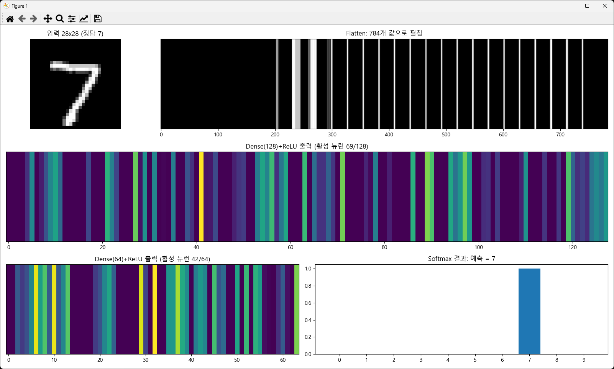
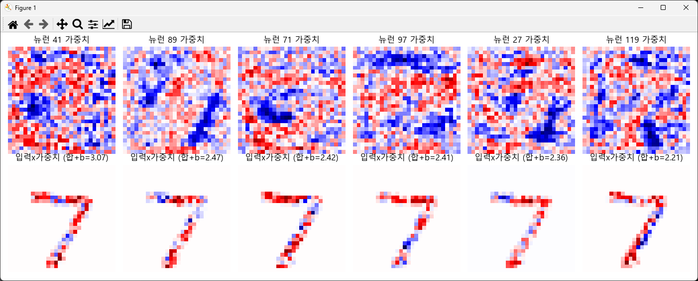

# MNIST 모델 레이어 흐름 시각화 정리

`mnist_pc_model.h5`의 가중치를 꺼내 numpy로 순전파를 직접 계산하고, 입력 이미지가 레이어를 지나며 변해 가는 과정을 시각화한 작업의 요약과 그림 해석입니다.

---

## 1. 진행 경과 요약

| 단계 | 내용 | 결과 |
|---|---|---|
| 1 | `mnist_pc_train.py`로 MNIST 분류 모델 학습 | `mnist_pc_model.h5` 저장 |
| 2 | 레이어 관계를 볼 도구 탐색 | Netron, TensorBoard, 활성화 추출, 가중치 시각화 |
| 3 | `pip install netron` 타임아웃 | 네트워크 다운로드 문제. 타임아웃 증가, 웹 Netron, 미러, whl 직접 설치로 해결 |
| 4 | `.h5` 사용법 확인 | 실행 파일이 아니라 **모델(구조+가중치) 데이터 파일**. `load_model`로 불러와 사용 |
| 5 | 원하는 형태가 아님 → 리버스 방식으로 전환 | 가중치를 꺼내 numpy로 순전파 직접 계산 후 단계별 시각화 (`mnist_flow_view.py`) |
| 6 | 한글 깨짐 | `Malgun Gothic` 폰트 지정과 `axes.unicode_minus=False`로 해결 |

---

## 2. 모델 구조

```
입력 28×28 → Flatten(784) → Dense(128, ReLU) → Dense(64, ReLU) → Dense(10, Softmax)
```

| 레이어 | 가중치 W shape | 편향 b shape | 파라미터 수 |
|---|---|---|---|
| Dense(128) | (784, 128) | (128,) | 100,480 |
| Dense(64) | (128, 64) | (64,) | 8,256 |
| Dense(10) | (64, 10) | (10,) | 650 |
| **합계** | | | **109,386** |

---

## 3. 리버스 방식의 핵심 원리

Keras의 `predict`를 쓰지 않고, 저장된 가중치로 아래 식을 직접 계산합니다.

```python
x0 = img.reshape(784)                           # Flatten
z1 = x0 @ W[0] + B[0];  a1 = np.maximum(z1, 0)  # Dense128 + ReLU
z2 = a1 @ W[1] + B[1];  a2 = np.maximum(z2, 0)  # Dense64 + ReLU
z3 = a2 @ W[2] + B[2]                           # Dense10 (로짓)
p  = softmax(z3)                                # 확률
```

- `z` = 가중합(행렬곱 + 편향), `a` = 활성화 함수를 통과한 값
- 각 단계의 중간값을 변수로 보관하기 때문에 그림으로 그릴 수 있습니다.
- 이 연산 구조(행렬곱, 편향 덧셈, ReLU, Softmax)가 MCU/NPU로 이식할 때 구현해야 할 연산 그 자체입니다.

---

## 4. 출력 그림 해석

### 4.1 첫 번째 창: 입력에서 결과까지의 흐름



| 위치 | 그림 | 의미 |
|---|---|---|
| 좌상단 | 입력 28×28 | 모델에 들어가는 원본 손글씨. 제목의 "정답"은 레이블 |
| 상단 우측 | Flatten 784 | 2차원 이미지를 1차원 784개 값으로 펼친 것. 밝을수록 픽셀 값이 큼(획이 있는 곳). 이 단계에서 공간 구조 정보는 모델 입력상 사라지고, 학습된 가중치가 위치별 중요도를 대신 표현함 |
| 중단 | Dense(128)+ReLU | 128개 뉴런의 출력. 색이 밝을수록 강하게 반응. **0(어두운 부분)은 ReLU가 음수를 잘라낸 비활성 뉴런**이고, 제목의 "활성 뉴런 n/128"이 실제 반응한 개수 |
| 하단 좌 | Dense(64)+ReLU | 앞 단계 특징을 한 번 더 조합한 64개 값. 활성 뉴런이 더 줄어들수록 정보가 압축·추상화되고 있다는 뜻 |
| 하단 우 | Softmax 막대그래프 | 숫자 0~9 각각의 확률. 가장 높은 막대가 예측 결과이고 제목에 표시됨 |

**읽는 법**

- 픽셀(784)에서 특징(128)을 거쳐 더 압축된 특징(64), 그리고 판단(10)으로 갈수록 정보가 **요약**됩니다.
- Softmax 막대 하나가 1에 가깝고 나머지가 거의 0이면 모델이 **확신**하는 것입니다. 두세 개가 비슷하면 헷갈리는 이미지이므로 오답 분석 대상입니다.
- 활성 뉴런이 소수만 켜져 있으면(희소성), ReLU가 입력별로 서로 다른 경로를 선택하고 있다는 의미입니다.

### 4.2 두 번째 창: 첫 은닉층 뉴런은 무엇을 보는가



이 입력에서 가장 크게 반응한 Dense(128) 뉴런 6개를 골라 두 줄로 보여줍니다.

| 줄 | 그림 | 의미 |
|---|---|---|
| 위 | 뉴런 n 가중치 (28×28) | 그 뉴런이 학습한 **"찾는 패턴"**. 빨강은 양수(이 위치에 획이 있으면 반응을 키움), 파랑은 음수(이 위치에 획이 있으면 반응을 줄임), 흰색은 0에 가까워 무관 |
| 아래 | 입력 × 가중치 | 이 입력에서 실제로 **기여한 부분**. 가중치 패턴과 입력 이미지를 픽셀별로 곱한 값. 빨강 영역이 반응을 올린 근거이고 파랑 영역이 깎은 근거 |

제목의 `합+b`는 아래 그림 전체를 합하고 편향을 더한 값, 즉 ReLU 통과 전 값 `z1[n]`입니다. 이 값이 양수로 클수록 해당 뉴런이 강하게 켜집니다.

**읽는 법**

- 위 그림의 빨강 패턴과 입력의 획이 겹치면 → 아래 그림에 빨강이 많이 생기고 → 뉴런이 활성화됩니다.
- 아래 그림에 파랑이 많으면 입력이 그 뉴런이 "싫어하는" 위치에 획을 가진 것입니다.
- 이 그림으로 "왜 이 뉴런이 켜졌는가"를 픽셀 단위로 설명할 수 있습니다.

---

## 5. 주의사항

- 은닉층 뉴런의 가중치가 사람이 이해하기 쉬운 숫자 모양으로 보이지 않을 수 있습니다. Dense 네트워크는 획 조각과 노이즈가 섞인 패턴을 학습하므로 정상입니다.
- 색 범위는 뉴런마다 `±최대절댓값`으로 정규화되어 있어서, **뉴런 간 색 진하기를 직접 비교하면 안 됩니다.**
- 입력 인덱스(`IDX`)를 바꾸면 다른 이미지로 같은 과정을 볼 수 있고, 오분류되는 샘플을 찾아 비교하면 학습 효과가 큽니다.
- MNIST는 검은 배경에 흰 숫자입니다. 직접 그린 이미지를 쓸 때는 색 반전이 필요합니다.
- 한글이 깨질 때는 `plt.rcParams['font.family'] = 'Malgun Gothic'`, 폰트 캐시 삭제, Jupyter 커널 재시작 순으로 확인합니다.

---

## 6. 확장 방향

1. **인터랙티브 HTML**: 가중치를 JSON으로 내보내 브라우저에서 숫자를 직접 그리면 각 레이어 값이 실시간으로 변하는 형태
2. **뉴런 연결선 그래프**: 레이어 사이를 선으로 잇고 굵기와 색으로 가중치·활성화 표현
3. **MCU/NPU 이식 분석**: int8 양자화 후 레이어별 값 범위, 오차, 메모리 크기 비교
4. **오분류 샘플 분석**: 예측이 틀린 이미지의 Softmax와 활성 뉴런 패턴을 정상 샘플과 비교


---
---


## 1. 구조(레이어 연결 관계) 시각화

Netron (가장 추천)

저장한 mnist_pc_model.h5 파일을 그대로 열면 레이어 연결, shape, 가중치까지 그래프로 보여줍니다.
설치 없이 https://netron.app 에서 파일을 드래그하면 됩니다. 데스크톱 앱, pip install netron도 가능합니다.
나중에 TFLite(.tflite)나 ONNX로 변환한 모델도 같은 방식으로 볼 수 있어서, MCU/NPU 쪽 작업에도 유용합니다.

keras.utils.plot_model (코드 안에서 바로)

```python
keras.utils.plot_model(
    model,
    to_file='model.png',
    show_shapes=True,
    show_layer_names=True,
    show_layer_activations=True
)
```

Graphviz 프로그램과 pip install pydot이 필요합니다.
주의: 현재 코드의 Sequential 모델은 model.summary()나 plot_model을 쓰려면 입력이 정의돼 있어야 하는데, 이 코드는 InputLayer가 있어서 바로 동작합니다.

## 2. 학습 과정 중 값 변화 보기

TensorBoard

```python
tb = keras.callbacks.TensorBoard(log_dir='logs', histogram_freq=1)
callbacks = [
    keras.callbacks.EarlyStopping(patience=3, restore_best_weights=True),
    tb
]

실행: tensorboard --logdir logs
```

Graphs 탭: 레이어 연산 그래프
Histograms/Distributions 탭: 레이어별 가중치와 편향 분포 변화
Scalars 탭: loss, accuracy 곡선

## 3. 중간 레이어의 실제 출력값(활성화) 보기

각 은닉층이 입력 이미지에 어떻게 반응하는지 직접 뽑아볼 수 있습니다.

```python
# 각 레이어 출력을 반환하는 모델 만들기
layer_outputs = [layer.output for layer in model.layers]
activation_model = keras.Model(inputs=model.inputs, outputs=layer_outputs)

# 테스트 이미지 1장 통과
sample = x_test[0:1].reshape(1, 28, 28, 1)
activations = activation_model.predict(sample)

for layer, act in zip(model.layers, activations):
    print(f"{layer.name:12s} 출력 shape: {act.shape}")
```

이 값을 matplotlib으로 막대그래프나 히트맵으로 그리면, Dense(128)와 Dense(64)가 어떤 뉴런을 활성화하는지 볼 수 있습니다.

## 4. 가중치 자체 보기

```python
for layer in model.layers:
    if layer.weights:
        w, b = layer.get_weights()
        print(layer.name, w.shape, b.shape)
````

첫 Dense(128)의 가중치(784×128)를 28×28 이미지 128장으로 reshape해서 그려보면, 각 뉴런이 어떤 패턴을 찾는지 시각적으로 볼 수 있습니다.

추천 순서
먼저 Netron으로 전체 구조 확인 (가장 빠름)
학습 과정이 궁금하면 TensorBoard
레이어 간 데이터 흐름을 직접 보려면 활성화 추출 코드

참고로 이 코드는 .h5 저장과 input_shape= 인자를 쓰고 있는데, 최신 Keras 3 환경에서는 경고가 나거나 .keras 형식을 권장합니다. 실행 시 문제가 생기면 model.save('mnist_pc_model.keras')로 바꾸고, InputLayer 대신 keras.Input(shape=(28,28,1))을 쓰면 됩니다.


